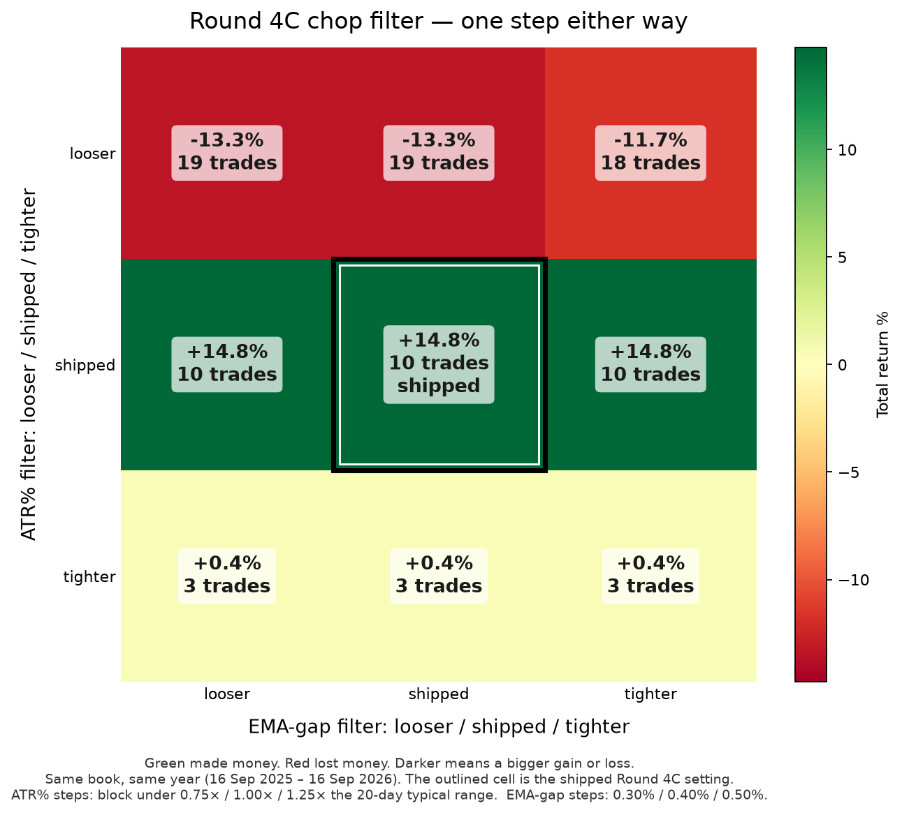

# Round 4C chop filter: plateau or spike?

This note is for the owner. It checks whether the shipped Round 4C result depends on two very specific filter settings, or whether the nearby settings still make money.

Round 4C's live rules were not changed. This folder only replays them.

## What the shipped filter actually does

Round 4C (PR #4, recorded in `backtest-params.json`) skips a **new** trade when either of these is true. A trade already open is left alone.

1. **ATR% filter.** Today's daily range is under the typical range of the last 20 days. "Typical" is the median. The shipped hurdle is **1.00×** that typical range. There is no fixed cutoff such as "ATR under 2%".
2. **EMA-gap filter.** The 20-day and 50-day trend lines are less than **0.40%** of the price apart.

Published Round 4C result on the 16 Sep 2026 snapshot: **+14.90%** return, **8.46%** max drawdown, Sharpe **1.564**, **9** trades, win rate **44%**. Round 3, the same book without this filter: **+4.33%**, **15** trades, drawdown **12.65%**, Sharpe **0.415**. Those figures are in the saved results. This test re-runs the engine; it does not paste the old percentage into the grid.

## The one step each setting moved

Nobody swept these values when Round 4C was built. The engine, the journal, and PR #4 each state the pair once. With no grid step on record, each hurdle moves **25%**, which is a round number an owner can see:

| Setting | Looser (easier to get in) | Shipped | Tighter (harder to get in) |
|---|---:|---:|---:|
| ATR% filter | block only under **0.75×** the 20-day typical range | **1.00×** | block under **1.25×** |
| EMA-gap filter | trend lines must be **0.30%** apart | **0.40%** | **0.50%** apart |

The 20-day window stays at 20 in every cell. Making that window 15 or 25 days changes *which* days look quiet. It does not reliably make the filter easier or harder, so it is the wrong "one step tighter."

Nine cells: looser / shipped / tighter for each setting. Everything else — prices, year, costs, exits, size, regime — stays put.

## The 3×3 result

Each cell shows return, max drawdown, trade count, win rate, and Sharpe. The shipped cell is in bold.

| ATR% filter \ EMA-gap filter | Looser (0.30%) | Shipped (0.40%) | Tighter (0.50%) |
|---|---:|---:|---:|
| Looser (0.75×) | -13.31% · DD 14.68% · 19 trades · WR 21% · Sharpe -1.32 | -13.31% · DD 14.68% · 19 trades · WR 21% · Sharpe -1.32 | -11.73% · DD 13.12% · 18 trades · WR 22% · Sharpe -1.16 |
| Shipped (1.00×) | +14.76% · DD 8.80% · 10 trades · WR 40% · Sharpe 1.49 | **+14.76% · DD 8.80% · 10 trades · WR 40% · Sharpe 1.49** | +14.76% · DD 8.80% · 10 trades · WR 40% · Sharpe 1.49 |
| Tighter (1.25×) | +0.37% · DD 4.04% · 3 trades · WR 33% · Sharpe 0.10 | +0.37% · DD 4.04% · 3 trades · WR 33% · Sharpe 0.10 | +0.37% · DD 4.04% · 3 trades · WR 33% · Sharpe 0.10 |

Return across the nine cells ran from **-13.31%** to **+14.76%**. **6 of 9** cells made money.

Green cells made money. Red cells lost money. The shipped cell is outlined.

## Verdict: MIXED

5 of the 8 neighboring cells made money, and 2 of the 8 finished within 5 percentage points of the shipped cell (+14.76%). That is neither a broad plateau nor a one-cell spike.

The picture is a stripe.

Changing the EMA-gap and leaving the ATR% hurdle alone does almost nothing: the looser ATR% row only moves from -13.31% to -11.73% when the EMA-gap changes (18–19 trades); the shipped ATR% row is the same result in all three EMA columns (+14.76%, 10 trades); the tighter ATR% row is the same result in all three EMA columns (+0.37%, 3 trades).

The ATR% hurdle is the sensitive setting. One step looser lets quieter days in, and the year loses money. One step tighter demands a bigger daily range, and almost all of the gain disappears. The shipped hurdle is the ATR% setting that produces the strong year. That fits the original Round 4C skip log: blocked entries were almost all "range too quiet," and the EMA-gap almost never blocked a trade on its own.

The label uses a rule set before looking at the numbers:

- **PLATEAU** — at least 6 of the 8 neighbors made money, and at least 6 of the 8 finished within 5 percentage points of the shipped cell.
- **SPIKE** — 2 or fewer neighbors made money.
- **MIXED** — anything in between.

**Small sample.** The shipped book is a handful of trades (the published run had 9; this replay of the shipped cell had 10). Two cells can print similar percentages because they took nearly the same trades. That is a real check on these two settings. It is not a large-sample proof that the strategy will keep working.

## Did the middle cell match the published +14.90%?

| | Published snapshot (16 Sep 2026) | This replay, shipped cell |
|---|---:|---:|
| Return | +14.90% | +14.76% |
| Max drawdown | 8.46% | 8.80% |
| Sharpe | 1.564 | 1.486 |
| Trades | 9 | 10 |
| Win rate | 44.44% | 40.00% |
| Final equity | $1,910.71 | $1,908.43 |

8 of the 9 published round-trips match this replay on entry date, exit date, and symbol. Missing from this replay: TSLA 2026-05-15 → 2026-06-01. Extra in this replay: SOL 2026-05-14 → 2026-05-18, NVDA 2026-05-18 → 2026-06-10. The last gold trade is in both lists, but this replay holds it to the end of the test instead of closing it for a weak trend, because the settled gold price that day is higher than the price the September run used.

This replay's shipped-cell trades:

| Entry | Exit | Symbol | Net P&L | Exit reason |
|-------|------|--------|---------|-------------|
| 2025-12-29 | 2026-01-21 | GOLD | $79.92 | RSI_OVERBOUGHT |
| 2026-02-03 | 2026-02-17 | GOLD | -$27.00 | BREAKEVEN_STOP |
| 2026-01-30 | 2026-03-02 | GOLD | $83.39 | TIME_STOP |
| 2026-04-30 | 2026-05-14 | NVDA | $146.76 | RSI_OVERBOUGHT |
| 2026-05-04 | 2026-05-14 | NVDA | $130.93 | RSI_OVERBOUGHT |
| 2026-05-14 | 2026-05-18 | SOL | -$32.63 | BELOW_MA50 |
| 2026-05-15 | 2026-06-10 | NVDA | -$44.52 | BELOW_MA50 |
| 2026-05-18 | 2026-06-10 | NVDA | -$39.44 | BELOW_MA50 |
| 2026-08-31 | 2026-09-10 | NVDA | -$39.66 | BREAKEVEN_STOP |
| 2026-08-28 | 2026-09-16 | GOLD | -$15.27 | BACKTEST_END |

Why a replay can differ from the September snapshot, even with the same rules:

- The calendar is the same published year. S&P sessions in this file run **2025-09-16 through 2026-09-16** (252 sessions). The published regime count was 252 days (153 risk-on / 83 transition / 16 risk-off). This replay's regime count is 153 / 83 / 16.
- Stocks and gold that the published trades actually touched match the saved prints in the middle of the year (NVDA 235.20 on 14 May 2026, TSLA 415.88 on 1 Jun 2026, gold 4837.50 / 4905.90 / 5311.60). The last gold print does not. The published Round 4C exit used **4288.70** on 16 Sep 2026. The settled gold future close in this file is **4387.50**. Round 3's own note for that same day was about 4384. All nine cells use this settled series, so they still compare fairly with each other.
- Bitcoin in the published test came from CoinGecko (116,763 on 17 Sep 2025 to 75,590 on 16 Sep 2026). CoinGecko's "last 365 days" cannot be rewound to that morning. This replay uses Yahoo Finance for bitcoin, ether, and solana so the file can be re-run. Bitcoin here is 116,843.19 on 2025-09-16 to 76,150.32 on 2026-09-16.

## What was not changed

Position size, leverage, the regime filter, pyramids, the breakeven stop, the 30-day time stop, costs, and the symbol list are the Round 4C rules. The shipped engine on PR #4 was not edited. The copy in this folder exists so the two hurdles can be moved for the test, and its defaults are the shipped hurdles.
